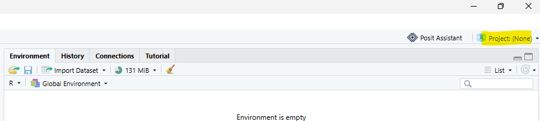
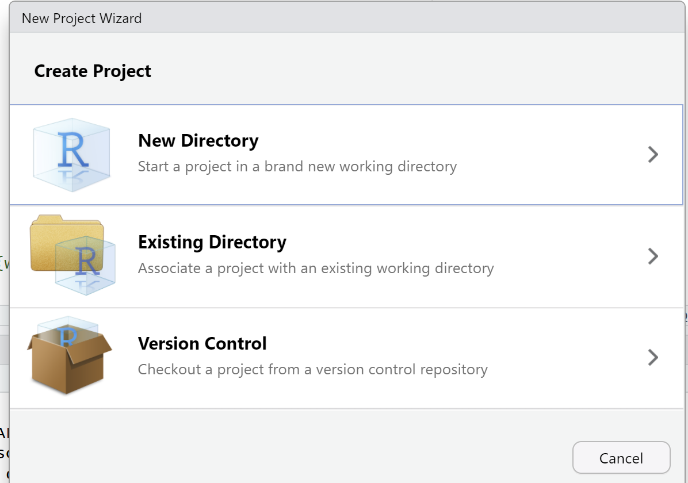
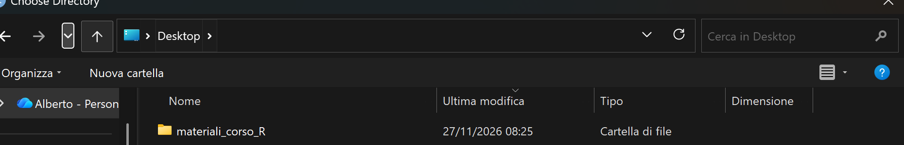
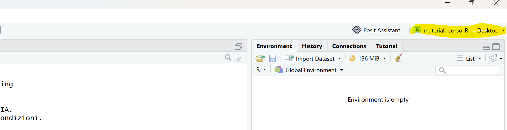
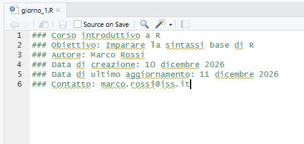
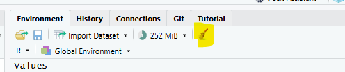

```{r}
#| include: false
pacman::p_load(webexercises)
```

# **Corso introduttivo al software statistico R**

# Modulo 01 Importazione ed esplorazione di database {.unnumbered}

## Obiettivi del modulo

-   Acquisire familiarità con l'interfaccia di RStudio
-   Capire l'importanza dei progetti in RStudio
-   Essere in grado di installare e caricare pacchetti
-   Essere in grado di eseguire calcoli semplici
-   Essere in grado di utilizzare funzioni
-   Essere in grado di leggere ed esplorare un database


## Formato dell'esercizio

<!-- Il paragrafo sotto è fisso: -->

Questo esercizio è progettato per essere una guida e per aiutarti a
completarlo in autonomia. Ti consigliamo fortemente di provare a
eseguire il codice prima di guardare le soluzioni. Per aiutarti,
abbiamo incluso in alcuni punti dei suggerimenti che possono
indirizzarti nella direzione giusta. Li troverai così:

<!-- ISTRUZIONI: Questo blocco "Suggerimento" va inserito ogni volta 
     che vuoi dare un aiuto parziale allo studente senza svelare 
     subito la soluzione (es. il nome di una funzione da usare, o un 
     argomento a cui prestare attenzione). Copia l'intero blocco 
     <details>...</details> e modifica solo il testo dopo </br>. -->

<details>

<summary style="text-decoration: underline; color: darkgreen;">

`r fontawesome::fa("lightbulb", fill = "gold")` Clicca per leggere un
suggerimento

</summary>

</br>

Questo è un suggerimento.

</br>

</details>


Le soluzioni, invece, avranno questo aspetto:

<!-- ISTRUZIONI: Questo blocco "Soluzione" va inserito alla fine di 
     ogni esercizio (o sotto-punto) e deve contenere codice R 
     eseguibile e commentato. Copia l'intero blocco 
     <details>...</details> e sostituisci il codice di esempio. Se la 
     soluzione richiede più passaggi, aggiungi commenti # nel codice 
     per spiegare ogni passaggio. Ricorda: niente etichette (label) 
     nei chunk, come indicato nelle istruzioni generali. -->

<details>

<summary style="text-decoration: underline; color: red;">

`r fontawesome::fa("check", fill = "red")` Clicca per vedere la
soluzione (provaci da solo prima!)

</summary>

</br>

```{r}
#| echo: true

print("Questo è un esempio di soluzione")

```

</br>

</details>

Durante l'esercizio troverai anche domande a risposta multipla, che
servono a verificare se stai seguendo correttamente lo svolgimento.
Le domande saranno simili a questa:

<!-- ISTRUZIONI: Questo blocco "Domanda" usa il pacchetto 
     `{webexercises}` per creare quiz a risposta multipla 
     auto-correttivi. Copia l'intero blocco ::: {.callout-note}...::: 
     e:
       - scrivi le opzioni di risposta nel vettore "opts"
       - indica la risposta corretta con answer = "..."
       - scrivi il testo della domanda dentro cat("Domanda: ...")
     Inserisci una domanda ogni volta che vuoi far verificare allo 
     studente di aver capito un concetto chiave prima di proseguire. -->

::: {.callout-note appearance="minimal" icon="false"}
**Prova a rispondere!**

::: webex-check
```{r}
#| results: asis
#| echo: false
pacman::p_load(webexercises)

opts <- c(
  "2",
  "5",
  answer = "4"
)


cat("Domanda di esempio: quanto fa 2 + 2?", longmcq(opts))

```
:::
:::

Lungo il modulo troverai anche due tipi di riquadri colorati. I
riquadri **gialli** segnalano errori frequenti o punti in cui R si
comporta in modo inatteso: leggili sempre, perché possono farti
risparmiare tempo.

<!-- ISTRUZIONI: Il box giallo "Attenzione a …" va usato per avvisi
     importanti: errori comuni, comportamenti di R che possono
     sorprendere, passaggi da non saltare. Il titolo inizia sempre con
     "Attenzione a" (es. "Attenzione ai nomi con spazi"). Copia
     l'intero blocco ::: {.callout-warning ...} ... ::: e modifica
     solo titolo e testo. -->

::: {.callout-warning appearance="default" icon="false"}
## Attenzione a …

Questo è un esempio di riquadro di attenzione.
:::

I riquadri **verdi** contengono invece approfondimenti facoltativi,
per chi vuole andare un po' oltre: puoi saltarli senza perdere il filo
dell'esercizio e tornarci in un secondo momento.

<!-- ISTRUZIONI: Il box verde "Approfondimento: …" va usato per
     contenuti facoltativi: funzioni alternative, scorciatoie, casi
     più avanzati. Lo studente deve poter completare l'esercizio anche
     senza leggerlo. Il titolo inizia sempre con "Approfondimento:"
     (es. "Approfondimento: gestire le date in R"). Copia l'intero
     blocco ::: {.callout-tip ...} ... ::: e modifica solo titolo e
     testo. -->

::: {.callout-tip appearance="default" icon="false"}
## Approfondimento: …

Questo è un esempio di riquadro di approfondimento.
:::

Ti consigliamo di provare comunque a rispondere e a eseguire il
codice da solo prima di consultare suggerimenti e soluzioni: è così
che si impara davvero a usare R.

## Iniziamo!

`r fontawesome::fa("play", fill = "darkgreen")` **Da qui comincia l'esercitazione.**

## Interfaccia di RStudio

RStudio è un'interfaccia per
rendere più semplice l'uso di R. RStudio ha quattro riquadri (se ne vedi
soltanto tre, probabilmente non hai ancora aperto uno script).

Riquadro **source**: In alto a sinistra, è uno spazio per modificare,
eseguire e salvare gli script. Gli script contengono i comandi che vuoi
eseguire. 

Riquadro **console**: Il riquadro inferiore sinistro è dove troviamo il
"motore" di RStudio: R. È qui che i comandi vengono effettivamente
eseguiti e vengono visualizzati output non grafici e messaggi di
errore/avvisi. Puoi scrivere ed eseguire direttamente i comandi nella
console, ma tieni presente che questi comandi non vengono salvati come
quando si eseguono i comandi da uno script.

Riquadro **environment**: In alto a destra, è utilizzato per
visualizzare gli oggetti (come per esempio database) importati o creati
nella sessione corrente.

Riquadro **plots, viewer, packages e help**: Il riquadro in basso a
destra. La scheda "plots" mostrerà i grafici, mentre altri output
interattivi – come tabelle HTML – verranno visualizzati nella scheda
"viewer". La scheda "packages" mostra i pacchetti installati e caricati,
permettendo anche l'installazione di nuovi pacchetti. Infine, la scheda
"help" si utilizza per ottenere informazioni su funzioni o pacchetti in
R.

Se vuoi saperne di più, leggi la sezione dell'EpiRhandbook [R
Studio](https://epirhandbook.com/en/new_pages/basics.html#rstudio)

## Creare un progetto di R

Lavorare dentro un progetto di RStudio è importante perché:

-   rende più semplice l'importazione di database, così come
    l'esportazione o il salvataggio di output
-   permette di organizzare il lavoro in modo efficiente
-   permette di condividere in modo efficiente il lavoro con altre
    persone: basta comprimere un progetto e inviarlo via email. Chi lo
    riceve può aprirlo e replicare esattamente il tuo lavoro!
-   può essere collegato a un software di version control come
    Git/Github

La cartella del corso, *materiali_corso_R*, contiene tre sottocartelle:

-   *script*: qui salverai i quattro script che scriverai durante la
    settimana: `pulizia_dati.R` (Moduli 1, 2 e 3), `tabelle_grouping.R`
    (Modulo 4), `plot.R` (Moduli 5, 6 e 8) e `join.R` (Modulo 7).
    All'inizio contiene solo la sottocartella *backup*, con le versioni
    corrette dei quattro script preparate da noi (`backup_pulizia_dati.R`,
    `backup_tabelle_grouping.R`, `backup_plot.R` e `backup_join.R`): puoi
    usarle per confrontarle con il tuo lavoro o per ripartire se qualcosa
    non funziona;
-   *dati*: contiene i dati che userai nelle esercitazioni;
-   *output*: qui salverai i grafici e le tabelle che produrrai.

Ora, assicurati che la cartella *materiali_corso_R* sia scaricata e **decompressa** sul tuo computer, poi apri RStudio e infine crea un progetto di RStudio dentro la cartella *materiali_corso_R*


<details>

<summary style="text-decoration: underline; color: red;">

`r fontawesome::fa("check", fill = "red")` Clicca per vedere la soluzione
(prova da solo prima!)

</summary>

</br>

Per creare un progetto, puoi cliccare su *File -\> New Project*. Puoi
anche farlo cliccando sul simbolo di R nell'angolo in alto a destra
(vedi immagine sotto) e poi scegliendo *New Project*.



Vedrai tre opzioni:

-   New Directory
-   Existing Directory
-   Version control



*New Directory* serve per **creare** una nuova cartella dove sarà creato
il progetto. Noi **non** vogliamo questa opzione perché abbiamo già una
cartella pronta.

*Existing Directory* serve per inserire il progetto in una cartella
già esistente sul tuo computer. **Scegli questa opzione** e seleziona
*browse*. Poi cerca la cartella *materiali_corso_R* e clicca su *Open*
come indicato nell'immagine sotto.



Dovresti vedere che RStudio si chiude e si riapre. Se tutto è andato a
buon fine, nell'angolo in alto a destra dovresti vedere adesso il nome
del progetto (come nell'immagine sotto).



Se non riesci, puoi trovare più dettagli su ogni passo in questa sezione
dell'EpiRhandbook su [R
Projects](https://epirhandbook.com/en/new_pages/r_projects.html)

</br>

</details>

:::: {.callout-note appearance="minimal" icon="false"}
**Prova a rispondere!**

::: webex-check
```{r}
#| results: asis
#| echo: false
opts <- c(
  "Un elenco di tutti i pacchetti di R",
  answer = "Un file che sembra il progetto che ho creato e anche le sottocartelle del corso",
  "Non si vede niente",
  "Un elenco delle funzioni di R"
)


cat("Domanda: Una volta creato il progetto, cosa vedi nel riquadro 'Files' in basso a destra?", longmcq(opts))

```
:::
::::

## Creare uno script

Il codice di R lo
scriveremo in uno script. Questo script è un documento che possiamo salvare e riprendere
quando vogliamo.


All'interno di uno script ci sono due elementi: **codice e commenti**.
Un commento è tutto ciò che scriviamo a destra del simbolo cancelletto
(`#`). I commenti aiutano te e gli altri a capire cosa fai e perché lo
fai. Vedi l'esempio sotto:

```{r}
#| eval: false
#| echo: true
# Questo è un commento
# Leggere i dati
db <- import("dati/dataset_esercitazione_raw.csv") %>%   # i commenti si possono anche inserire dopo il codice
# filter(age > 50)                          # si possono anche usare per disattivare pezzi di codice
  count()

```

Ora crea un nuovo script e salvalo nella sottocartella `script` col nome `pulizia_dati`. In questo script scriverai il codice dei Moduli 1, 2 e 3. Nello script, comincia scrivendo dei commenti dove indichi: nome e cognome; obiettivo dello script; tua email e la data.

<details>

<summary style="text-decoration: underline; color: darkgreen;">

`r fontawesome::fa("lightbulb", fill = "gold")` Clicca per leggere un
suggerimento

</summary>

</br>

Per aprire uno script, seleziona *File -\> New File -\> R Script*.

</br>

</details>

<details>

<summary style="text-decoration: underline; color: red;">

`r fontawesome::fa("check", fill = "red")` Clicca per vedere la soluzione
(prova da solo prima!)

</summary>

</br>

Il tuo script dovrebbe assomigliare a questo:



</br>

</details>

## Funzioni semplici

Ricorda che c'è una differenza fondamentale tra chiedere a R di **fare
qualcosa e di stamparlo nella console** e chiedere a R di **fare
qualcosa e salvarlo nell'Environment**. Se noi scriviamo una funzione e
**non** usiamo **l'operatore di assegnazione** `<-` R lo farà e lo stamperà
nella console. Se invece lo usiamo, lo salverà nell'Environment e nella
console vedremo soltanto il pezzo di codice che abbiamo lanciato, **ma
non l'output**.

Crea quindi un vettore con i numeri: 24, 98, 233, 9823, 3, -76 e salvalo
nell'Environment con il nome *numeri*. Usa le funzioni adatte per calcolare: 
numero più alto, numero più basso e somma. Salva poi la media in un oggetto 
chiamato *media_numeri*. Crea un vettore con le parole: Roma, Torino, Napoli, 
Milano, Bari e usa una funzione che trasformi questi nomi in lettere maiuscole e 
salva il vettore nell'Environment col nome *citta_italiane*

<details>

<summary style="text-decoration: underline; color: darkgreen;">

`r fontawesome::fa("lightbulb", fill = "gold")` Clicca per leggere un
suggerimento

</summary>

</br>

Per creare un vettore devi inserire i numeri (o le città) all'interno
della funzione "concatenate" o `c()` separati da virgole. Ricorda che le
parole in R devono essere inserite tra virgolette, mentre i numeri no.

Se vuoi salvare il vettore nell'Environment, scrivi il nome del vettore,
poi l'operatore di assegnazione `<-` e poi il vettore.

Per calcolare la media puoi usare la funzione `mean()`, mentre per
rilevare il numero più alto `max()` e il numero più basso `min()`.
Invece, per trasformare un vettore testuale in lettere maiuscole puoi
usare la funzione `toupper()`.

</br>

</details>

<details>

<summary style="text-decoration: underline; color: red;">

`r fontawesome::fa("check", fill = "red")` Clicca per vedere la soluzione
(prova da solo prima!)

</summary>

</br>

```{r}
#| echo: true
numeri <- c(24, 98, 233, 9823, 3, -76)
max(numeri)
min(numeri)
sum(numeri)
media_numeri <- mean(numeri)


citta_italiane <- c("Roma", "Torino", "Napoli", "Milano", "Bari")
citta_italiane <- toupper(citta_italiane)

```

</br>

</details>

::: {.callout-warning appearance="default" icon="false"}
## Attenzione a errori e warning

Quando esegui del codice, R può rispondere nella console con due tipi di avviso, che vanno sempre letti:

- un **errore** (`Error`) blocca il comando: R non produce alcun risultato. Ad esempio, `mean(Numeri)` restituisce `Error: object 'Numeri' not found`, perché R distingue maiuscole e minuscole e l'oggetto si chiama `numeri`.
- un **warning** (`Warning message`) non blocca il comando: R produce comunque un risultato, ma ti avvisa che potrebbe non essere quello che ti aspetti. Ad esempio, `mean(citta_italiane)` restituisce `NA` con il warning `argument is not numeric or logical: returning NA`.

I warning sono i più insidiosi: è facile ignorarli perché il codice "funziona", ma possono segnalare un problema nei dati che si propagherà a tutte le analisi successive.

Il messaggio di solito indica quale funzione ha generato il problema e perché: leggilo prima di modificare il codice. Se non lo capisci, copialo in un motore di ricerca: quasi sempre qualcun altro ha già avuto lo stesso problema. A seconda delle impostazioni del computer, i messaggi possono comparire in italiano (`Errore`, `Messaggio di avvertimento`) invece che in inglese.
:::

:::: {.callout-note appearance="minimal" icon="false"}
**Prova a rispondere!**

::: webex-check
```{r}
#| results: asis
#| echo: false
opts <- c(
  "4231.1",
  "12.98",
  answer = "1684.167",
  "9874.32"
)


cat("Domanda: Qual è la media del vettore 'numeri'?", longmcq(opts))

```
:::
::::

## Leggere ed esplorare dati di una coorte di vaccinati

Adesso cominceremo ad analizzare dati più complessi che somigliano ai
dati che un epidemiologo trova nella vita reale.

Il database che useremo puoi trovarlo nella sottocartella
`dati` e si chiama `dataset_esercitazione_raw`. Questo
database contiene dati fittizi che imitano dati individuali di una
coorte di persone vaccinate: caratteristiche demografiche (sesso, età,
regione), comorbidità (indice di Charlson), stato HIV, data di
vaccinazione, data di fine follow-up e data dell'evento. Per ogni persona con HIV sono state scelte, di norma, due persone senza HIV con la stessa regione (`REGION`), lo stesso sesso (`Sex`), la stessa classe d’età (`Age group`, 18-59 o 60+) e la vaccinazione nella stessa settimana. Questo procedimento si chiama **appaiamento**: la persona con HIV e i suoi due “controlli” hanno lo stesso valore della variabile group

Puoi aprire il database in Excel e dare uno sguardo se vuoi.

Nei prossimi passi eseguiremo le azioni necessarie per leggere ed
esplorare questo database.

### Installare e caricare i pacchetti necessari

La prima parte dello script
(oltre a includere – commentate – alcune informazioni sull'obiettivo,
autore, data dell'ultimo aggiornamento e dettagli di contatto) consiste
nell'installare e caricare i pacchetti.

Fortunatamente c'è un pacchetto che svolge questo compito in modo molto
efficace: `{pacman}`. La funzione `p_load()` di questo pacchetto
installerà tutti i pacchetti elencati non ancora installati e li
caricherà. Se un pacchetto elencato era già stato installato, lo
caricherà e basta. Puoi trovare maggiori informazioni
sull'installazione/caricamento di pacchetti nella sezione
[Packages](https://epirhandbook.com/en/new_pages/basics.html#packages)
dell'EpiRhandbook.

Adesso cancella le funzioni che abbiamo scritto prima e lascia nello script
soltanto i commenti descrittivi iniziali. Poi pulisci l'Environment cliccando
sulla scopa in alto a destra. Utilizzando l'approccio di `pacman::p_load()`, 
prova a installare e caricare i seguenti pacchetti: `{rio}`, `{janitor}`, 
`{lubridate}`, `{skimr}`, `{epikit}`, `{gtsummary}` e `{tidyverse}`.

::: {.callout-tip appearance="default" icon="false"}
## Approfondimento: conflitti tra pacchetti e operatore `::`

Quando farai analisi più complesse, potresti finire per usare un lungo elenco di pacchetti. Sfortunatamente, pacchetti diversi possono avere funzioni con lo stesso nome. Ad esempio, il pacchetto `{dplyr}` (già installato con `{tidyverse}`) ha una funzione chiamata `select()` che usiamo frequentemente per selezionare un sottoinsieme di variabili di un database. Ma anche altri pacchetti, come `{MASS}`, hanno una funzione chiamata `select()`. Questo può creare problemi se vuoi selezionare variabili con `select()` di `{dplyr}` ma R pensa che tu stia chiamando `select()` di `{MASS}`. Questo fenomeno si chiama **masking** (mascheramento): `select()` di `{dplyr}` è mascherata da `select()` di `{MASS}`, perché R usa la funzione del pacchetto caricato per ultimo.

Dato che è più probabile che tu usi funzioni di `{tidyverse}`, assicurati che sia l'ultimo pacchetto nel tuo elenco `p_load()`, in modo che le sue funzioni (incluse quelle di `{dplyr}`) "prevalgano" sempre.

In alternativa, puoi indicare esplicitamente da quale pacchetto prendere una funzione con l'operatore `::`, nella forma `pacchetto::funzione()`. In questo modo l'ordine di caricamento diventa irrilevante e il codice è più leggibile, perché è subito chiaro quale funzione stai usando:

```r
dplyr::select(dati, eta, sesso)   # usa sempre select() di {dplyr}
MASS::select(...)                 # usa select() di {MASS}
```

L'operatore `::` funziona anche se il pacchetto non è stato caricato con `library()` o `p_load()`, purché sia installato: è quindi utile anche quando ti serve una sola funzione di un pacchetto e non vuoi caricarlo per intero.
:::

<details>

<summary style="text-decoration: underline; color: darkgreen;">

`r fontawesome::fa("lightbulb", fill = "gold")` Clicca per leggere un
suggerimento

</summary>

</br>

Per pulire l'Environment puoi cliccare sulla scopa in alto a destra: 



</br>

</details>

<details>

<summary style="text-decoration: underline; color: red;">

`r fontawesome::fa("check", fill = "red")` Clicca per vedere la soluzione
(prova da solo prima!)

</summary>

</br>

```{r}
#| echo: true
# installa (se necessario) da CRAN e carica i pacchetti da utilizzare
pacman::p_load(
  rio, # importazione dati
  skimr, # ottieni panoramica dei dati
  janitor, # pulizia dati e tabelle
  lubridate, # lavorare con le date
  epikit, # per creare categorie di età
  gtsummary, # statistiche riassuntive, test e regressioni
  tidyverse # gestione e visualizzazione dati
)
```

</br>

</details>

```{r}
#| echo: false
#| include: false
dati_raw <- import("dati/dataset_esercitazione_raw.csv")
```

### Leggere i dati

Esistono diversi modi in cui puoi importare i vari data frame. Ci sono
tre versioni del file che vogliamo leggere (`dataset_esercitazione_raw`):
una è un file Excel, l'altra è un file csv e l'ultima è un file con
formato di R (.rds). Un modo per leggerlo potrebbe essere utilizzare
funzioni specifiche di R, ad esempio, `read_excel()` da `{readxl}`,
`read.csv()` o `readRDS()`. Tuttavia, questo significherebbe dover usare
una funzione diversa per ogni tipo di file e, a volte, doverne
impostare con attenzione gli argomenti. Ad esempio, il nostro file csv
usa il punto e virgola (`;`) come separatore e ha una riga di testo
iniziale ("Dati creati il 23/10/2026") prima dei nomi delle variabili:
`read.csv()` con le impostazioni predefinite non lo leggerebbe
correttamente. Fortunatamente, esiste un approccio più efficiente che
consiste nell'usare la funzione `import()` da `{rio}` per aprire
**qualsiasi** file. Questa funzione riconoscerà il tipo di file e
sceglierà la funzione appropriata per importarlo (nel caso del nostro
csv, riconoscerà da sola anche il separatore e la riga iniziale). Se
vuoi saperne di più sulle funzioni di importazione, leggi il capitolo
[Import and Export](https://epirhandbook.com/en/new_pages/importing.html#import-data)
dell'EpiRhandbook.


Importa il database `dataset_esercitazione_raw.csv` utilizzando `import()` da `{rio}` e salvalo nell'Environment col nome `dati_raw`. Nella funzione `import()` va indicato il percorso del file, cioè anche la cartella in cui si trovano i dati.

<details>

<summary style="text-decoration: underline; color: red;">

`r fontawesome::fa("check", fill = "red")` Clicca per vedere la soluzione
(prova da solo prima!)

</summary>

</br>

```{r}
#| echo: true
#| eval: false
# leggere i dati di HIV
dati_raw <- import("dati/dataset_esercitazione_raw.csv")

```

</br>

</details>

### Esplorare il database

Prova a scoprire il numero di variabili e righe, la classe delle variabili e se questa corrisponde alla sua natura (ad esempio, le "date" sono considerate "date" da R?). Guarda poi le diverse categorie delle variabili su `gender`, `hospital`, `outcome` o `fever.` Pensi di aver bisogno di ricodificarne qualcuna?
Infine, esplora la variabile `AGE`: di che classe è? Pensi si debba cambiare qualcosa?

::: {.callout-tip appearance="default" icon="false"}
## Approfondimento: le classi degli oggetti in R

Ogni oggetto in R ha una **classe**, che determina come R lo tratta: quali operazioni puoi farci e come si comportano le funzioni che lo ricevono. Ad esempio, `mean()` funziona su un vettore di numeri. Puoi conoscere la classe di un oggetto con la funzione `class()`.

Le classi che incontrerai più spesso per i singoli valori (e i vettori che li contengono) sono:

| Classe      | Contenuto                         | Esempio                     |
|-------------|-----------------------------------|-----------------------------|
| `numeric`   | numeri reali                      | `3.5`, `120`                |
| `integer`   | numeri interi                     | `5L`, `1:10`                |
| `character` | testo                             | `"maschio"`, `"Roma"`       |
| `logical`   | valori vero/falso                 | `TRUE`, `FALSE`             |
| `factor`    | variabili categoriche con livelli | `factor(c("basso", "alto"))`|
| `Date`      | date                              | `as.Date("2024-03-15")`     |

Un **vettore**: una sequenza di valori tutti della stessa classe, creata  con `c()`. La classe del vettore è quella dei suoi elementi. Ricorda che un vettore può contenere una sola classe: se mescoli classi diverse, R le converte tutte in quella più generale (*coercion*). Ad esempio, `c(1, "a", TRUE)` diventa un vettore `character`. È una causa frequente di errori quando si importano dati.

:::

<details>

<summary style="text-decoration: underline; color: darkgreen;">

`r fontawesome::fa("lightbulb", fill = "gold")` Clicca per leggere un
suggerimento

</summary>

</br>

Un modo efficiente per esplorare i dati è usare la funzione `skim()` dal
pacchetto `{skimr}`, poiché fornisce tutte le informazioni necessarie con
un solo comando. Naturalmente, ci sono diverse alternative. Per
conoscere le diverse categorie in una variabile, puoi usare la funzione
`tabyl()` da `{janitor}`, che ti fornirà conteggi e percentuali di ogni
categoria nella variabile di dati.

</br>

</details>

<details>

<summary style="text-decoration: underline; color: red;">

`r fontawesome::fa("check", fill = "red")` Clicca per vedere la soluzione
(prova da solo prima!)

</summary>

</br>

```{r}
#| echo: true
# esplorare tutto il database con skimr
skim(dati_raw)

# esplorare categorie di una variabile "character" o "factor"
tabyl(dati_raw, Sex)
tabyl(dati_raw, REGION)
tabyl(dati_raw, Charlson_Index)
```

</br>

</details>

::::::::: {.callout-note appearance="minimal" icon="false"}
**Prova a rispondere!**

::: webex-check
```{r}
#| results: asis
#| echo: false
opts <- c(
  answer = "16",
  "6611",
  "82",
  "4"
)


cat("Domanda: Quante variabili ci sono nel database?", longmcq(opts))

```
:::

::: webex-check
```{r}
#| results: asis
#| echo: false
opts <- c(
  "6",
  answer = "0",
  "137",
  "876"
)


cat("Domanda: Quante osservazioni sono considerate 'missing' nella variabile 'Age group?", longmcq(opts))

```
:::

::: webex-check
```{r}
#| results: asis
#| echo: false
opts <- c(
  "28",
   answer =  "5",
  "17",
  "3"
)


cat("Domanda: Quante variabili numeriche ci sono nel database?", longmcq(opts))

```
:::

::: webex-check
```{r}
#| results: asis
#| echo: false
opts <- c(
  "52.7",
   "0.9",
  "48",
  answer = "0.524"
)


cat("Domanda: Qual è la media della variabile 'Charlson score'?", longmcq(opts))

```
:::

:::::::::


## Lo script completo

Ecco come dovrebbe essere la parte del tuo script relativa a questa
esercitazione. Confrontala con la tua: i commenti e alcuni comandi possono essere diversi, ma le funzioni utilizzate devono fare le stesse cose, nello stesso ordine. È anche il codice da copiare e
incollare all'inizio delle prossime esercitazioni, per partire tutti
dallo stesso punto.

<details>

<summary style="text-decoration: underline; color: blue;">

`r fontawesome::fa("check", fill = "blue")` Clicca per vedere lo script
completo

</summary>

</br>

```{r}
#| echo: true
#| eval: false
### Corso introduttivo a R
### Obiettivo: Imparare la sintassi base di R
### Autore: Marco Rossi
### Data di creazione: 10 dicembre 2026
### Data di ultimo aggiornamento: 11 dicembre 2026
### Contatto: marco.rossi@iss.it


# Caricamento pacchetti ---------------------------------------------------
pacman::p_load(
  rio, # importazione dati
  skimr, # ottieni panoramica dei dati
  janitor, # pulizia dati e tabelle
  lubridate, # lavorare con le date
  epikit, # per creare categorie di età
  gtsummary, # statistiche riassuntive, test e regressioni
  tidyverse # gestione e visualizzazione dati
)


# Importazione dati -------------------------------------------------------
dati_raw <- import("dati/dataset_esercitazione_raw.csv")

# Esplorazione ------------------------------------------------------------
skim(dati_raw)
```

</br>

</details>

Salva lo script.

## Riepilogo

In questo modulo hai visto:

-   **RStudio** e i suoi quattro riquadri: source (gli script), console
    (dove R esegue i comandi), environment (gli oggetti creati) e
    plots/viewer/packages/help.
-   **I progetti di RStudio**, che tengono insieme dati, script e output
    in un'unica cartella e rendono il lavoro facile da organizzare e
    condividere.
-   **Gli script e i commenti**: il codice si scrive in uno script da
    salvare, e tutto ciò che segue il simbolo `#` è un commento che R
    non esegue.
-   **L'operatore di assegnazione** `<-`: senza, R stampa il risultato
    nella console; con questo operatore, invece, lo salva nell'Environment 
    come un oggetto che possiamo utilizzare dopo.
-   **I pacchetti**: `p_load()` di `{pacman}` installa (se necessario) e
    carica i pacchetti in un solo passaggio.
-   **Le funzioni**: che prendono un input e restituiscono un output. 
-   **L'importazione dei dati**: `import()` di `{rio}` legge qualsiasi
    formato di file (csv, Excel, rds…) riconoscendolo da sola.
-   **L'esplorazione dei dati**: `skim()` di `{skimr}` fornisce in un
    solo comando dimensioni, classi delle variabili, valori mancanti e
    statistiche descrittive; `tabyl()` di `{janitor}` mostra conteggi e
    percentuali delle categorie di una variabile.

## Risorse aggiuntive

| Argomento | Risorsa |
|---------------------------------------|---------------------------------|
| Elementi essenziali di R | Epi R Handbook, cap. 3 "R basics": <https://epirhandbook.com/en/new_pages/basics.html> |
| Passaggio da altri software statistici a R | Epi R Handbook, cap. 4 "Transition to R": <https://epirhandbook.com/en/new_pages/transition_to_R.html> |
| Importazione dati | Epi R Handbook, cap. 7 "Import and export": <https://epirhandbook.com/en/new_pages/importing.html> |

